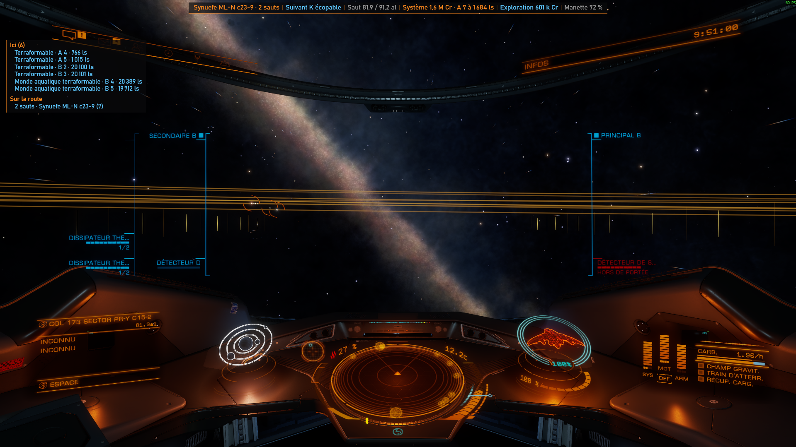

# EDC — Elite Dangerous Companion

A Windows companion for Elite Dangerous: your own music, calm out of combat and loud in a fight,
and a discreet banner over the game with what matters right now — the next star, fuel, the target
and its bounty, valuable planets, material sources, credits per hour.

EDC reads the files the game writes (the journal, `Status.json`, `NavRoute.json`, `Cargo.json`). It
never touches the game itself and asks no account.



*In flight, with the interface in French: the banner at the top (route, next star, jump range, what
the system is worth, exploration data, controller battery), the planets worth mapping here and along
the route on the left.*

## Features

**Music**
- Plays the music folders you add, switching to combat tracks when the journal says you are fighting
  and back to calm two minutes after the last sign of combat.
- A folder added is sorted by ear: each track is listened to and filed as calm or combat from how
  loud, dynamic and bright it sounds against the rest of its folder, the title having the last word
  ("battle" is combat, "credits" is calm). Fix any track with one switch while it plays.
- Like a track to hear it more often, exclude it for good, force calm or combat, media keys, the
  track's title over the game as it starts.
- MP3, WAV, FLAC, M4A and WMA.

**Over the game** (borderless windowed mode)
- A banner at the top: route and next star (scoopable or not, neutron, white dwarf), jump range,
  fuel, the target with its bounty and threat, pending bounties and bonds, high grade emissions,
  credits per hour for combat and exploration, controller battery.
- Warnings in the middle of the screen: shields down, interdiction, overheating, refuel here before
  a run of unscoopable stars, jumping away with valuable planets left unmapped, low health or oxygen
  on foot.
- An exploration panel: the planets paying above the threshold you choose (or a first discovery or
  first mapping, if you ask), each with its value, here in the visit order that takes the least
  supercruise, worked out from their orbits, and along the route system by system; and the material
  sources the journal reports.
- On the galaxy map: whether the system targeted was never discovered, is known in part or fully
  scanned, and its planets above the threshold.
- At a station: what not to forget — rearm, refuel, repair, limpets, bounties to cash in, data to
  sell.

**In the window**
- Combat: credits per hour from bounties and bonds, what to cash in, the target, the nearest
  hazardous resource extraction site (and the nearest one held by your power), the nearest station
  with every service.
- Exploration: credits per hour from the bodies scanned this session, data to sell, valuable planets.
- Neutron route: plotted by Spansh from your ship's range, the next step copied to the clipboard as
  you reach each one.
- Commander: every rank with its progress to the next and how to earn it, what the next navy rank
  unlocks, and your reputation with each superpower.
- English and French.

## Install

Windows 10 or later, with the [.NET 9 Desktop Runtime](https://dotnet.microsoft.com/download/dotnet/9.0).
Download the installer from the [latest release](https://github.com/MatthieuFereyre/elite-dangerous-companion/releases/latest)
and run it: EDC installs for the current user, without administrator rights, and starts
with Windows, waiting in the notification area for the game. It updates itself from the releases
published here.

Then, in the window's Music tab, add your music folders. **No music comes with EDC**: it plays your
own files.

## Your data

Everything EDC writes is in `Saved Games\Elite Dangerous Companion`, next to the game's journals:

| File | |
|---|---|
| `settings.json` | every setting |
| `library.json` | your music folders and how each track is sorted |
| `edc.log` | what EDC did: tracks, switches and why |

`--data-dir <folder>` points EDC at another folder.

## Online services

EDC asks public sites, sending system names only — nothing about you:

- on its own: [EDSM](https://www.edsm.net) for what each new system and the system targeted on the
  galaxy map hold, and
  [Spansh](https://spansh.co.uk) for the valuable planets along each new route;
- from a button of the window: Spansh for neutron routes and the nearest full station,
  [edtools.cc](https://edtools.cc) with Spansh for hazardous resource sites.

If [EDMarketConnector](https://github.com/EDCD/EDMarketConnector) is installed, EDC can start it
with the game: it is the tool that shares your journal with EDDN, EDSM and Inara.

## Build

```powershell
dotnet test src\EDC.sln
dotnet publish src\EDC -c Release -o app
```

The tests need Windows (WPF, Media Foundation). Pushing a `vX.Y.Z` tag builds the installer and
publishes the release (`.github/workflows/release.yml`). Texts live in `src/EDC/Resources/Strings.resx`
(English) and `Strings.fr.resx` (French); a test checks that every text has its translation.

## Credits

Built with [NAudio](https://github.com/naudio/NAudio), [WPF UI](https://github.com/lepoco/wpfui),
the [CommunityToolkit.Mvvm](https://github.com/CommunityToolkit/dotnet) and
[H.NotifyIcon](https://github.com/HavenDV/H.NotifyIcon).

## License

[MIT](LICENSE).

Elite Dangerous is a trademark of Frontier Developments plc. EDC is a fan-made tool, not affiliated
with or endorsed by Frontier Developments.
